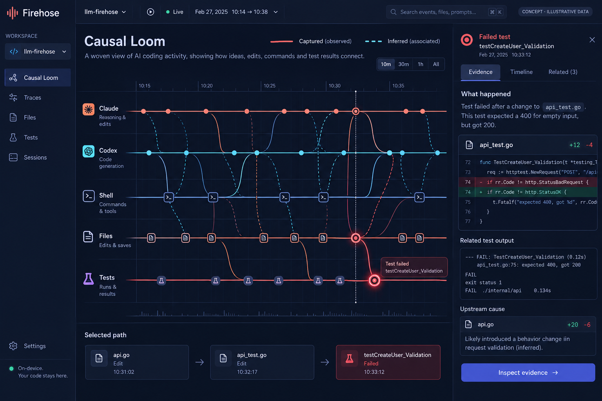
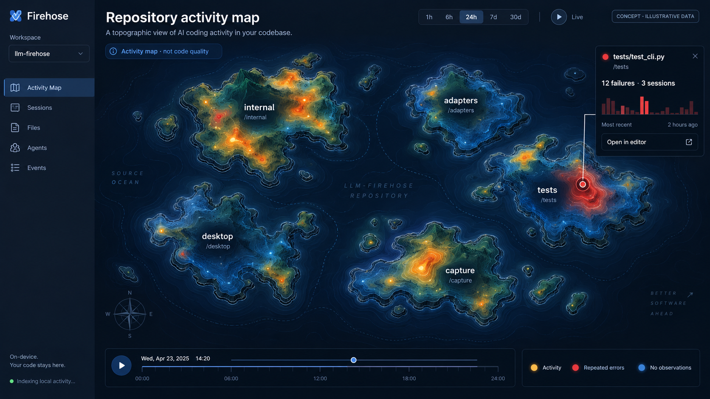
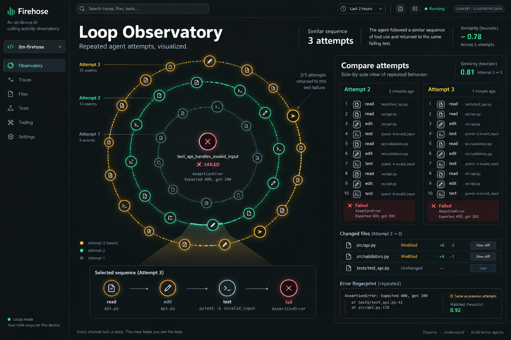
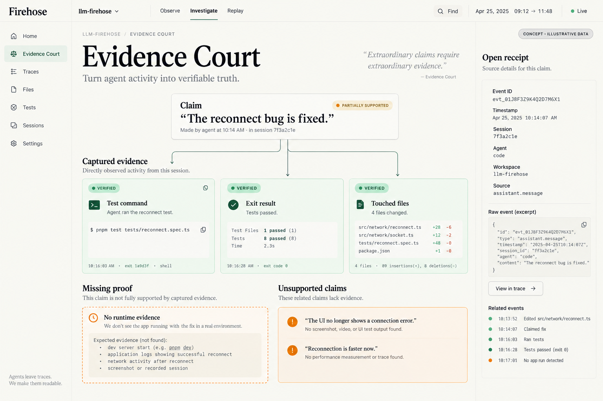
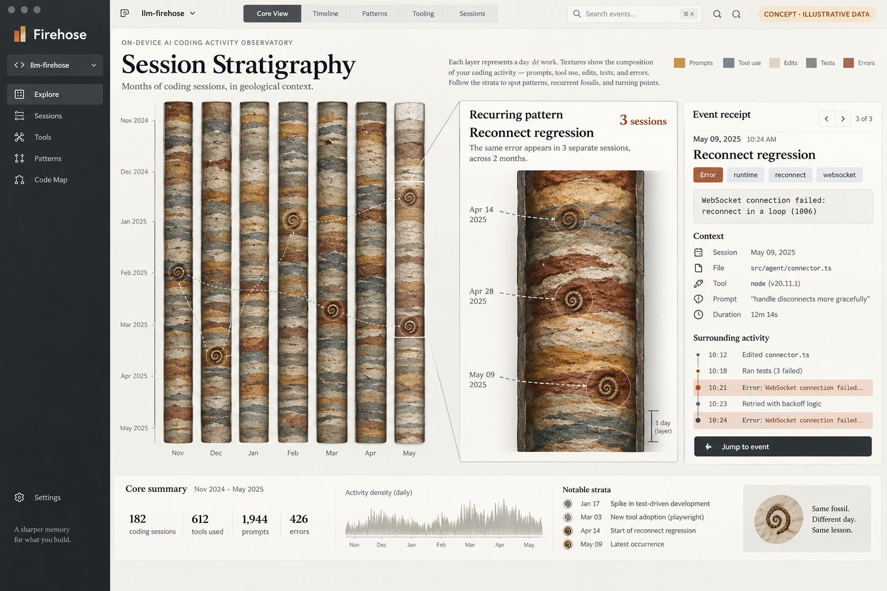
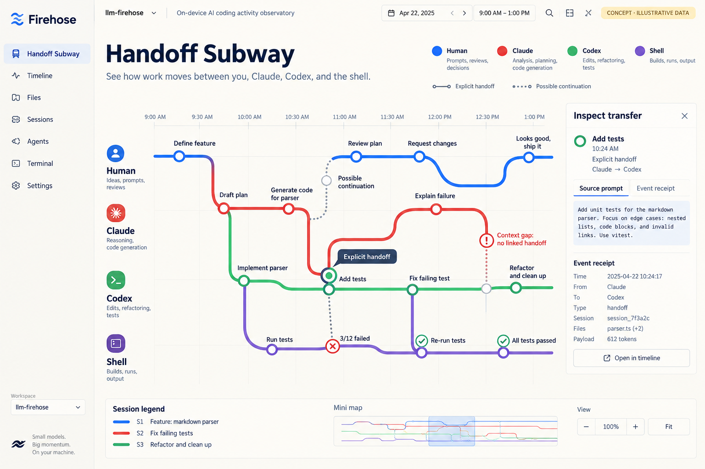
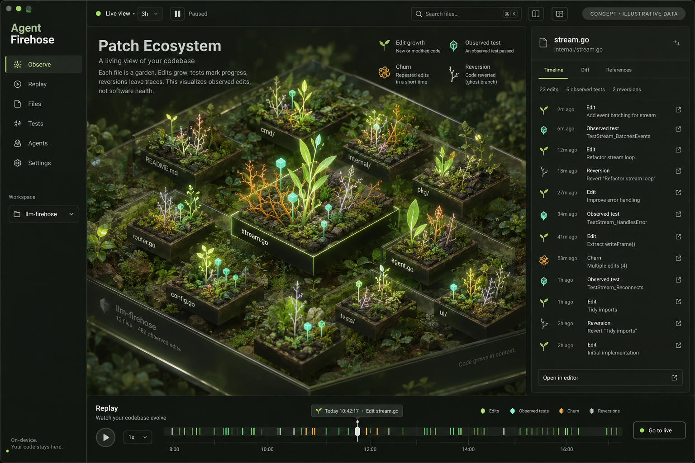
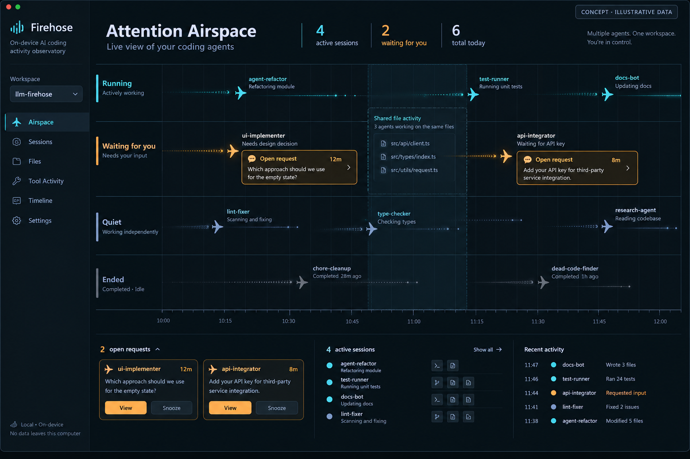
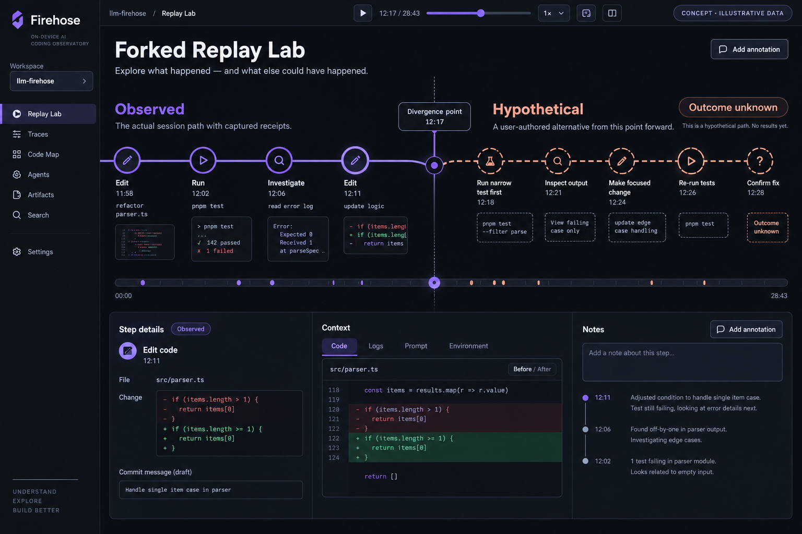
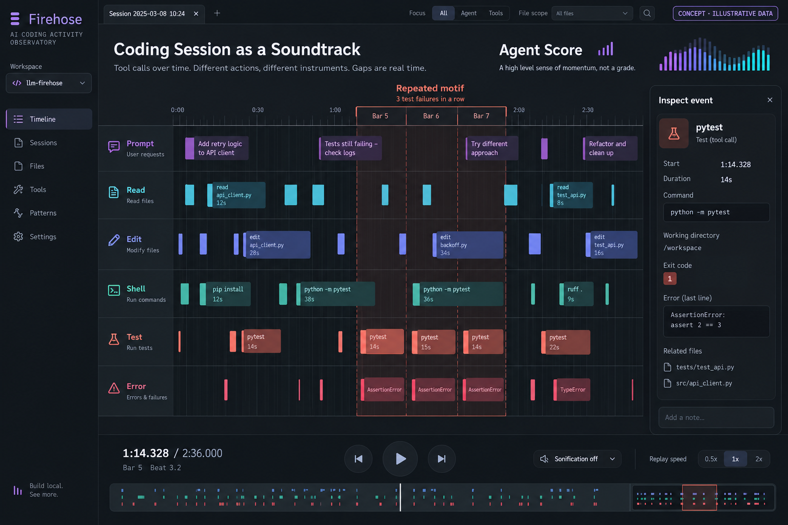

# Ten wild extensions for Agent Firehose

Created October 15, 2026. Speculative concepts with illustrative data, not implemented features. Generated using the built-in image generation tool; exact prompts are in prompts.json. Based on the current event envelope, capture architecture, local API, workspace graph, and attention views. No application code changed.

Best initial experiments: Loop Observatory for repeated effort; Evidence Court for claim verification; Handoff Subway for cross-agent continuity.

## 1. Causal Loom

Follow the thread from a failed test back through tool calls, edits, and agent turns. Select a knot to isolate its upstream and downstream observations across agents.

**Useful for:** A cross-agent failure investigation that would otherwise require opening several transcripts.

**Implementation seam and limits:** Start with source-provided parent/call/trace IDs. Temporal or file-based associations remain dashed; correlation alone does not establish root cause.

## 2. Repository Weather

Watch activity fronts move across a topographic repository map. Heat shows edits and tool activity; storm cells show repeated observed errors. Scrub time to see where effort accumulated.

**Useful for:** Orient yourself after an overnight run or spot a small module absorbing disproportionate attention.

**Implementation seam and limits:** Join captured file observations to the local workspace graph. Stable terrain positions matter. Activity is not code quality; quiet may mean missing capture.

## 3. Loop Observatory

Repeated read → edit → test → fail sequences become nested orbits. Compare attempts to see what changed while the same failure persisted.

**Useful for:** Notice an agent spending its fifth attempt on the same unsuccessful strategy.

**Implementation seam and limits:** Local sequence matching and error fingerprints can power an initial version. Similarity is heuristic, and users choose when to intervene.

## 4. Evidence Court

Pin a completion claim and attach receipts for commands, results, and changed files. Missing requested evidence remains an explicit gap. Open any receipt at its source.

**Useful for:** Review an agent's 'fixed' claim before committing or shipping.

**Implementation seam and limits:** Start with user-selected claims and a manual evidence checklist. Automated claim extraction is optional and local. A captured green test supports that test result, not universal correctness.

## 5. Session Stratigraphy

Treat months of sessions as geological layers. Recurring error signatures become fossils spanning multiple strata; drill into one to recover its earlier appearances and surrounding work.

**Useful for:** Find the older session where the same failure was investigated, or explore how a project’s working patterns changed.

**Implementation seam and limits:** Daily aggregates and a local signature index are rebuildable from history. Preserve source timestamps and capture gaps; visual layer thickness needs a consistent legend.

## 6. Handoff Subway

Human, Claude, Codex, and shell activity become transit lines. Handoffs are interchanges; selected stations expose the prompt and receipts. Missing explicit connections appear as context gaps.

**Useful for:** Understand how a task moved between tools and where a crucial instruction stopped traveling.

**Implementation seam and limits:** Use explicit source links or user annotations for confirmed transfers. Shared files and similar prompts only suggest a possible continuation.

## 7. Patch Ecosystem

A replayable terrarium of file activity: edits grow shoots, reversions leave ghost branches, and repeated changes tangle into amber stems. Select a bed to inspect its real chronology.

**Useful for:** Build spatial memory for a codebase and notice where a supposedly small change kept expanding.

**Implementation seam and limits:** Needs reliable edit/reversion observations; optional local Git inspection adds evidence where available. Growth expresses activity, not quality. Provide a flat accessible view.

## 8. Attention Airspace

Local sessions fly through running, waiting, quiet, and ended bands. Requests for human input form holding patterns, while shared file activity becomes a highlighted airspace.

**Useful for:** Manage several simultaneous agents and find the one waiting longest for your decision.

**Implementation seam and limits:** Build over session and attention projections. Quiet means no recent observations, not proof of productive background work. Shared activity does not prove a write conflict.

## 9. Forked Replay Lab

Freeze a session at a decision point and sketch an alternative route beside the captured path: run a narrower test, inspect an error, or defer an edit. Keep the hypothetical branch visibly separate.

**Useful for:** Turn a frustrating session into a retrospective or teaching artifact.

**Implementation seam and limits:** An annotation layer can work without rerunning anything. Outcomes and timings on hypothetical branches remain unknown. A future execution experiment would need a separate isolated checkout.

## 10. Agent Score

A coding session becomes a sequencer: prompts, reads, edits, commands, tests, and errors occupy separate tracks. Repeated failures form motifs. Optional local sonification makes patterns audible.

**Useful for:** Recognize repeated behavior during a long replay or monitor activity while looking elsewhere.

**Implementation seam and limits:** Map captured categories and event times to visual and sound cues. Render duration only when start/end evidence exists; keep real gaps. Sound is opt-in and never affects capture.

