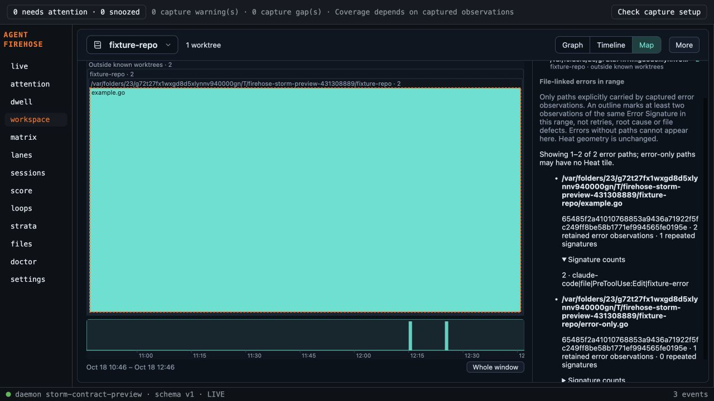

# Activity error overlay validation

Base e007b2f; code4ba67871809bd040561de9649f62766ca47e5aad.

- TDD: backend initially failed for missing additive fields. A later failing case proved two path aliases resolving to one file double-counted one observation; per-event resolved-path dedupe fixed it.
- Frontend initially failed for missing error derivation/list and missing tile outline. All focused tests passed after implementation. Existing notice assertions updated to include explicit old-daemon unavailability.
- Full frontend491 tests/33files passed, TypeScript and Vite build passed.
- Go formatting empty, vet/full tests and CLI build passed. Sidecar build and3 Rust tests passed.
- Independent spec review PASS: canonical identity, exact explicit-path attribution, independent Heat, deterministic caps/omissions, brushed recurrence and error-only list matched plan.
- Independent standards review PASS: privacy/identity/canonical-ID filters preserved; aliases deduped; safe text; no new dependencies or external services; honest unbounded aggregation memory limitation.

Browser: temporary isolated daemon built from this backend, no source loops/live spool/user hooks. Three clearly labelled normalized contract mutations of the existing captured file fixture were admitted into a temporary spool/repository. Two error observations on example.go produced one dashed recurrence outline and Heat2; one error-category observation on error-only.go appeared in the error list without adding Heat. A2h time brush narrowed until one occurrence remained: outline disappeared, exact list count became1 and tile geometry stayed fixed. Whole window restored the outline. Canonical signature details were inspectable; no browser console errors. The temporary empty Git repo used the existing unresolved-root display fallback, preserving exact path/workspace grouping. This proves normalized contract/UI behavior, not newly observed raw adapter failures.

Requested external-model final review has not passed: Argon4 High quota exhausted and Sonnet5.5 High expected reset around18:01UTC October18; no Gemini3.1 model in configured service. Keep draft. Hosted CI pending. The application remains local-first; no runtime network dependency added. Full scan aggregation memory remains proportional to matching history despite bounded response/DOM.
