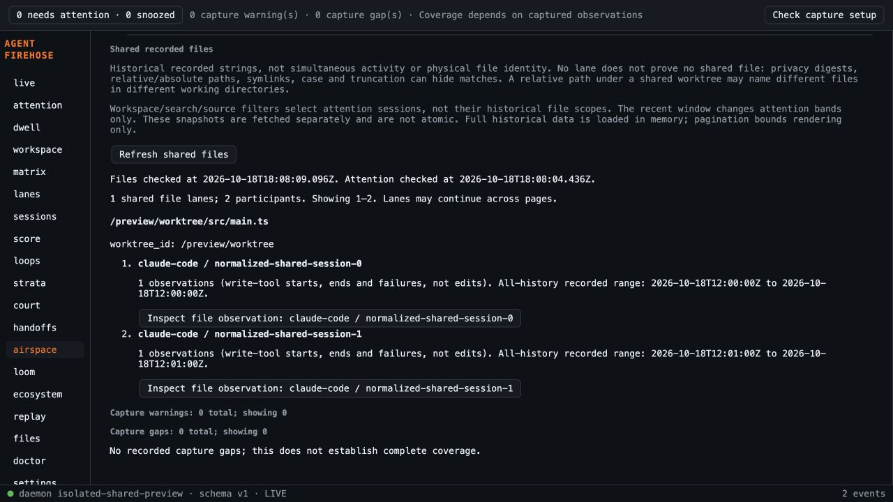

# Shared recorded files validation

Code checkpoint: 6ce01f3, based on combined dependency aef9ab4 after fresh-main e007b2f worktree creation.

- TDD: original model stub failed four behavioral assertions; revised historical-scope cases failed before implementation. Empty-kind regression failed before correction. New Airspace integration test failed on missing Load control before integration. DOM suite initially failed module loading before view implementation; no claim that this alone is behavioral red evidence.
- Focused final Airspace/Files suites: 55 tests pass. Initial full frontend run on f30529e: 737 tests across58 files; production build passes. Final rerun after review fixes pending.
- Go formatting, vet, full tests and CLI build pass. Sidecar rebuilt; Rust tests pass (3 library tests). No Go/native production code changed after these checks.
- Browser on6ce01f3: actual capture engine and daemon, isolated temporary home/spool, no capture sources or installed hooks. Two explicitly labelled normalized contract mutations of an existing real Claude file event were admitted with different session IDs and identical recorded path/scope. Verified explicit load, one lane/two participants, exact receipt identity/path and Close focus restoration. Original fixture summary remains unmodified and can name a different file; this is a normalized test mutation, not a new raw capture. Over40 participants is DOM-tested only.
- Temporary daemon4634 and Vite1434 stopped; preview-only source removed. Screenshot below. No installed/native interactive claim.
- Independent spec found empty-kind defensive-input gap, fixed with failing-first test. Standards suggested shared receipt predicate, extracted and used by both panels. Follow-ups pending.
- Argon small availability probe replied available, but tool-reading attempt could not run headlessly; inline-material substantive review then returned quota exhaustion (145h56m57s). No permission settings changed. Gemini3.1 absent from configured list. Sonnet5.5 High fallback implementation review running; unavailable reviews never count as approval.

