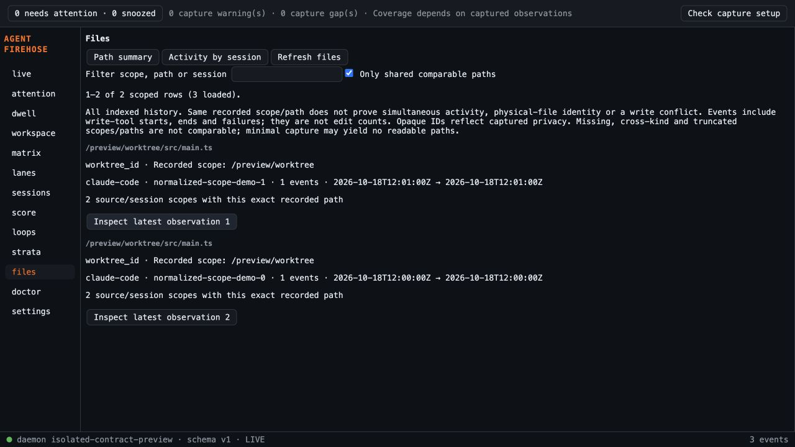

# File session activity validation

Code 7b2bd61 from fresh main e007b2f. Plan Sonnet 5.5 High initial findings corrected; follow-up PASS. Independent spec and standards reviews found summary-path truncation and close/retry focus issues; fbe53d1 fixes them with a regression test and both follow-ups PASS.

- 500 frontend tests across 34 files and TypeScript/Vite build pass.
- gofmt output empty, go vet, full go test and CLI build pass. Final UI-only fixes do not change Go/native code.
- Sidecar build and cargo test pass (3 native unit tests).
- 10,000-row scale test: 50,292,544 allocated bytes, 2,647,781 JSON bytes. Snapshot/JSON benchmark one iteration: 13.725ms, 21,532,408 B/op, 142 allocations. These characterize this fixture and machine, not a runtime bound.
- Actual daemon browser preview: three explicitly normalized mutations of a captured Claude file event, isolated temporary spool/home, no live sources or installed hooks. Verified old summary count3, unknown workspace row, two comparable session scopes, shared-only filter, exact full receipt and close focus. Both temporary servers stopped and preview source removed. No installed desktop proof claimed.
- Full history response and per-tuple projection growth remain disclosed. Exact recorded labels do not prove physical identity/concurrency/conflict. Opaque privacy IDs remain opaque.

Initial requested implementation review found no blocker/medium issues; all low findings are fixed. Sonnet 5.5 High final follow-up PASS on 7b2bd61; hosted checks remain open. Browser evidence was recorded at fbe53d1; subsequent changes preserve its short-path flow and add full long-path visibility/retry retention.
