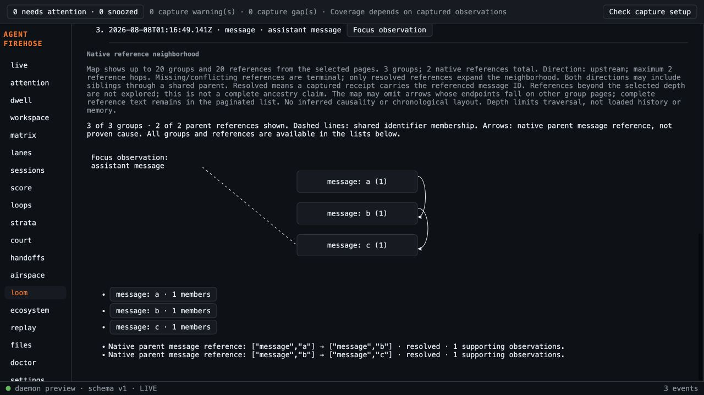

# Native reference traversal validation

Fresh-main base d2c4488909ffb906fbb4e8285c651800201f8499; code329a1a04aa91a4611eb23e2455a6c0d729e2eade. PR43 was already merged when work began. PR49/50 session-name changes were not imported or edited.

- TDD: first traversal test failed because loomTraversal was absent; first DOM test failed because Reference depth was absent. Implemented and verified public model/DOM seams. Fixtures are documented normalized graph-contract mutations of the existing adapter-derived OpenCode fixture, not newly invented adapter payloads.
- Final frontend:761 tests across59 files pass, production TypeScript/Vite build passes.33 Loom tests cover direction, chains, forks, cycles, depth cap/normalization, terminal conflicts, scope isolation,10k fan-out, defaults, receipt cancellation/late rejection, pagination resets and option preservation.
- Empty gofmt, go vet, full Go tests and CLI build passed. Sidecar built and3 Rust tests passed. Subsequent changes are frontend labels/tests/docs only; final full frontend gates rerun.
- Independent spec and standards reviews PASS on6049b42 and follow-up329a1a0. Standards duplication note fixed by having the one-hop helper delegate to production traversal.
- Claude Sonnet5.5 High plan review identified clarifications; dispositions recorded in plan and review report. Final implementation review PASS atb794d48; low wording/coverage notes fixed329a1a0; final bounded follow-up PASS. Substantive Argon quota was exhausted earlier this day; no skipped review counted as approval.
- Browser proof atb794d48: production Capture Engine Admit + daemon Handler, temporary home/spool, no sources/hooks or user configuration. Three normalized message observations a→b→c from the captured OpenCode fixture; focusc/upstream/depth2 displayed3 groups/2 references; downstream displayed onlyc/0references. Screenshot adjacent. Later changes only refine labels and add tests; they do not alter traversal. This is browser evidence, not installed-native interaction proof.
- Preview initially used an origin rejected by the existing API policy. Retried on the existing allowed localhost:1420 origin with daemon127.0.0.1:4636, without altering trust policy. Temporary helper removed and both servers stopped.
- Depth bounds traversal, not loaded session history or total model memory. Only native resolved references expand; no causal or cross-agent inference. Cached traversal reuse is statically reviewed, not tested with implementation spies.

Hosted exact-head checks are a separate publication gate. Main merge remains human-approved.

