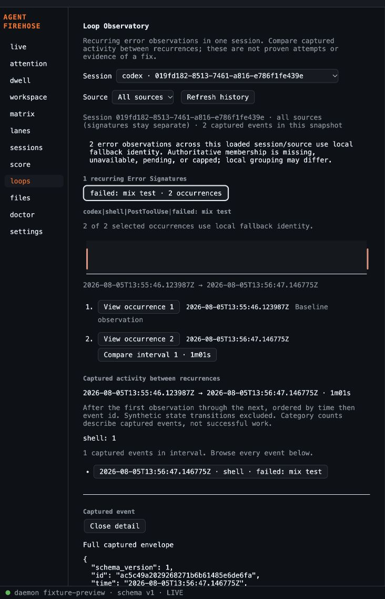

# Loop Observatory validation

Code commit: `85444e9`. Base: `a150daa16408e6578467ceb1d196cb07022751b2`.

## Local gates

- `gofmt -l .`: empty; `go vet ./...`: passed; `go test ./...`: passed.
- `pnpm -C apps/tauri-desktop exec vitest run --no-file-parallelism`: 31 files, 476 tests passed, 25.40 seconds.
- `pnpm -C apps/tauri-desktop build`: TypeScript and Vite production build passed.
- `bash scripts/build-sidecar.sh`: passed; `cargo test --manifest-path apps/tauri-desktop/src-tauri/Cargo.toml`: 3 tests passed.
- Large-history model: 100,000 fixture-derived events, three signatures and exact interval counts. This verifies functional scale; it is not a WKWebView performance measurement.

## Interactive browser check

In-app browser, local Vite on 1428, isolated fixture API on 4629. API served existing `score/fixture.errsig.json` and `score/fixture.session.json`, with timeline allowlisting and full event lookup. No live spool, agent hooks or production settings touched. The fixture API deliberately returned no membership records to exercise disclosed local fallback.

Verified navigation → Loops → the captured Codex session with two `mix test` failures → one recurring signature with two observations → 1m01s interval and shell count 1 → full event payload on explicit selection. Source filtering cleared prior detail. Switching to the real 101-event Claude fixture showed the nonrecurring state. Screenshot is from the real captured fixtures with their existing sanitized paths.

This is browser interaction evidence, not a packaged native UI playtest. Native compile/test evidence is separate above.

## Independent review axes

Standards review of `a150daa...85444e9`: no actionable documented-standard violations or defect-level smells. Nonblocking judgment: signature helpers live under Score; extract a shared module when further consumers justify it. Read-only; no independent test execution.

Specification review of the same immutable range: no actionable implementation defects or scope creep. It verified lifecycle guards, session-local counts, authoritative membership, interval bounds and bounded rendering. It flagged missing completion evidence in the then-in-progress journal; this record supplies local/browser outcomes. Hosted CI remains independently tracked on the PR.

## Hosted gate

[PR #35](https://github.com/treetopdevs/llm-firehose/pull/35) owns the current CI/review state. Initial Go CI passed; desktop platform builds were pending when this record was written. The PR's Autofix checkbox was enabled and read back checked. A checked control records configuration, not proof that an unattended repair has run. Merging remains human-approved.
