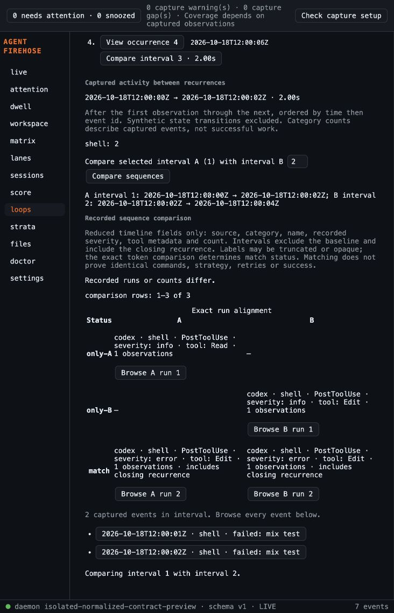

# Loop sequence adversarial review

Model: claude-sonnet-5-5, effort high, existing account. Read-only review of e007b2f..0f03e0e.

**Not a PASS.** I found no blockers in the token, LCS or scope logic, but there are three medium issues and several low ones. This was a static read of `e007b2f..HEAD`. I ran no tests, made no edits, used no network and delegated nothing. I did not write the plan-mode plan file.

## Medium

1. **Run buttons carry the wrong run number in aligned mode.**
   - `sequence-view.ts:29` passes the row index `i` into `runContent`, and `sequence-view.ts:25` labels the button `Browse ${side} run ${index+1}`.
   - If an `only-B` row comes first and the next row is `match(a0,b1)`, the A button reads "Browse A run 2" for A's first run.
   - The `data-key` also uses the row index (`sequence:run:A:<row>`), not the run's ordinal.
   - The tests only match the "Browse A run" prefix, so they miss it.
   - Fix: pass each run's real ordinal, or label the buttons by row.

2. **Any `derive()` rebuilds the comparison and cancels open detail, even when nothing changed.**
   - `index.ts:174-178` calls `buildComparison` on every derive, and it calls `cancelDetail()` (`index.ts:50`).
   - The plan says to rebuild once, when the retained pair's inputs change after late membership (plan line 15).
   - `derive()` also runs on the 4s signature timeout, on lookup failure and on membership arrival. Each run discards the open run, its page position and any inspected detail, and it re-announces the notice.
   - Fix: rebuild only when the endpoint pairs or their numbering changed.

3. **A false "Comparison cleared" notice appears when no comparison existed.**
   - `index.ts:165` passes the message "Comparison cleared: selected signature membership changed." whenever `activeKey` is set and its group disappears.
   - `activeKey` is set on the first draw (`index.ts:114`). When authoritative signatures arrive and replace the fallback key, every user sees this notice, including users who never compared.
   - Fix: pass the message only when `comparison` is set.

## Low

4. **Missing and opaque tool values display identically.**
   - `sequence.ts:17` shows `typeof tool==='string'?tool:'Unavailable'`, but the keys do distinguish them (`sequence.ts:14`).
   - The plan asks to distinguish absent, string and opaque/redacted values (plan line 12).
   - Adjacent runs, or `only-A`/`only-B` rows, can look identical: "tool: Unavailable" for both a missing and a digest value.
   - A real tool named "Unavailable" looks the same too. `Not recorded` for a missing name or severity has the same collision.
   - Truncation at 160 characters (`sequence-view.ts:5`) can also make different names look equal.

5. **The number input is rebuilt on every keystroke.**
   - `index.ts:142` runs `resetComparison()` and `draw()` on each `input` event.
   - The input is recreated and `keepFocus` refocuses it. Caret position and IME composition are at risk, and the evidence list is redrawn and cancelled each time.
   - I did not run this in a browser.

6. **Status notices are fragile for screen readers and keyboard users.**
   - The `role=status` notice is a fresh element on every draw (`index.ts:110`). It also stays on screen through unrelated redraws.
   - It sits above the signature list, far from the Compare control.
   - After an invalid or self-compare, `referenceDraft` is cleared, so the input silently reverts to the default while the message still talks about the user's entry.

7. **Closing a run sends focus to the section heading.**
   - `sequence-view.ts:22` focuses `heading` on close rather than the Browse control that opened the run.

8. **Test gaps.**
   - The 100k test only checks the early-return result (`rows` undefined); it never asserts that no matrix was allocated.
   - No Loops-level test covers the derive-without-change cancellation (finding 2).
   - No test covers a false notice (finding 3) or row-versus-run numbering (finding 1).

## Verified OK

- **Token:** `sequence.ts:14` is a JSON tuple of source, category, name, severity and `[missing|recorded, canonical(tool)]`. Missing, string and object values are distinct, and object keys are sorted.
- **Tool field:** the daemon's timeline view keeps `tool_name` (`internal/capture/history.go:174`).
- **Merging:** adjacent equal tokens merge with ordered events. `closing` is true only when the last event of the run is the closing recurrence (`sequence.ts:16`).
- **Boundaries and mutation:** the interval excludes the baseline and includes the closing recurrence. Inputs are not mutated.
- **LCS:** the table is `Uint16Array` and at most 201×201. A diagonal match is taken when tokens and counts are equal, otherwise A is consumed before B on `>=`. That gives at most 400 rows. The ambiguous A,B versus B,A case is correct.
- **Cutoff:** above 200 runs on either side returns `rows: undefined`. `equal` is computed on all runs in O(n).
- **Observations:** every observation is reachable by paging, 40 per page. The labels use `textContent` with `stripControl`.
- **Cancellation:** comparand edits, Compare, run open/close and every pager call `cancel`. Receipt lookup is explicit only, and the existing `selectEvent` guards are unchanged.
- **Scope and reset:** A and B come from the same group, and identity is stored as endpoint-ID pairs. Self-compare and out-of-range values are rejected. Reset is wired into session, source, signature, interval-select and reload.
- **View cache:** the DOM view survives ordinary redraws with page state intact.
- **Keys and focus:** data-keys are namespaced. Pagers fall back to the region heading, and the Next labels are distinct.

## Remediation at 3472958

Correct actual per-side run numbers; preserve cached comparison across unchanged membership derivation; suppress false clearing notices; distinguish missing from opaque tool labels and disclose label limitations; preserve input DOM while typing and invalid values; keep status mounted; restore run-close focus to its opener. New regression tests failed before fixes. Independent specification follow-up PASS and standards review PASS.

## Browser evidence

Real isolated daemon/projection and local frontend, with seven explicitly normalized contract mutations of captured Codex events (not new raw adapter fixtures). Verified two-interval alignment, matching closing recurrence, full local receipt lookup, and self-comparison rejection clearing prior comparison/detail. Screenshot reflects final 3472958 controls. Temporary preview source removed and both preview processes stopped; user capture/config untouched. No installed native/device proof.

## Final local gates

503 frontend tests in 34 files; production build; empty gofmt output; go vet; full go test; CLI build; sidecar build and cargo test all passed. Sonnet follow-up PASS on 3472958.

## Sonnet 5.5 High follow-up

**PASS.** I found no blocking or medium bugs in `e007b2f..3472958`. This was a static read only: I ran no tests, made no edits, used no network and delegated nothing. I did not run it in a browser.

## Prior findings

| # | Finding | Status |
|---|---|---|
| 1 | Run numbering | **Fixed.** `sequence-view.ts:28` maps each run object to its own index in `comparison.a` or `comparison.b`. Both `compareSequences` and the `rows` use the same run objects, so the map lookups resolve. Each run's `data-key` is now unique per side and ordinal. The new test covers an `only-B` row before a match. |
| 2 | Unchanged `derive()` resetting the view | **Fixed.** `index.ts:179` rebuilds only when the A:B numbering changed. The retained view, open run and page state survive. Sequence content depends only on the endpoint-ID ranges of `model.events`, and those don't change with signature membership. |
| 3 | False "Comparison cleared" notice | **Fixed.** `index.ts:166` shows the message only when a comparison existed. |
| 4 | Opaque labels | **Fixed.** The labels are now `Missing tool metadata` and `Opaque recorded metadata` (`sequence.ts:17`). The view copy discloses that labels can be truncated or opaque and that the exact token decides a match. |
| 5 | Input redraw | **Fixed.** `index.ts:143` no longer calls `draw()` on `input`. It removes the view and caption, resets the comparison and keeps the draft. An invalid value or a self-compare keeps the draft through the redraw. |
| 6 | Status | **Mostly fixed.** The notice is one persistent `role=status` element (`index.ts:21`). |
| 7 | Close focus | **Fixed.** Close returns focus to the opener and falls back to the heading if the opener is detached. The opener is resolved at click time. Paging comparison rows clears the open run, so the opener cannot go stale while a run is open. |

## Remaining low limitations

- **Validation notice placement.** The notice now sits after `body`, below the pager of up to 40 evidence rows. A sighted user who enters an invalid or self-compare B may see nothing near the Compare control unless they scroll. Screen readers are told. Rendering the notice next to the control would fix this.
- **Repeated announcements.** `draw()` sets `notice.textContent` on every redraw, even to the same text. Some screen readers may re-announce it when the user pages.
- **Typing in B clears event detail.** The `input` handler calls `resetComparison()`, which calls `cancelDetail()`. Typing in B therefore also clears an unrelated event detail the user had open from the evidence list, even when no comparison existed.
- **Label collisions remain possible.**
  - A real tool, name or severity with the same text as a placeholder looks identical.
  - Different opaque values share one label.
  - Truncation can make long labels look alike.
  - Match status is still exact, and the copy discloses this.
- **Focus loss on redraw.** `keepFocus` restores only elements that have a `data-key`. If a redraw happens while focus is on the run title or the comparison heading, focus is lost.
- **Late-signature input reset.** A late signature `derive()` rebuilds the input and loses the caret or IME state. This only happens in the 4-second signature window.
- **Comparison cleared by late signatures.** If authoritative signatures arrive after the user has already compared, the key changes and the comparison is cleared. This is deliberate, and the notice is now accurate.
- **Test gaps.** I saw no test for the input handler's no-redraw behaviour, caret or focus, or for the notice's position and announcement. The browser behaviour is unverified.

Plan mode was active and `ExitPlanMode` isn't among my tools, so I wrote no plan file and this is the full deliverable.

Low limitations are recorded for later accessibility refinement; exact comparison correctness and bounded rendering pass. This slice does not expand into a general Loops focus redesign.
