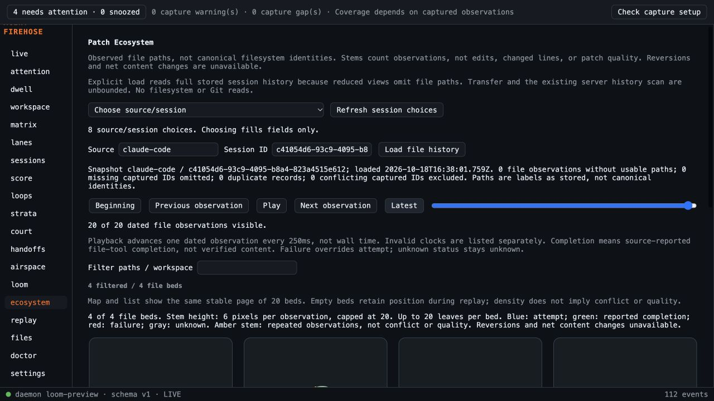

# Combined prototype validation

Code reviewed: e388b6083abe40b6d86d7c249e1f42adc141e803; base main e007b2f. Local merge commits preserve exact feature heads recorded in decision D56. Original PRs remain open; no main merge authorized for these changes.

- Two new integration tests failed first: shared Court entry retained another view's receipt; leaving Court did not abort its pending lookup. Existing refresh cancellation plus shared-pane clearing fixes both; drafts persist.
- Full frontend: 674 tests, 51 files passed with no-file-parallelism. TypeScript and Vite build passed.
- gofmt produced no files; go vet and all Go tests passed; CLI build passed.
- Sidecar built; Rust tests passed (3 unit tests).
- Independent spec review: PASS, no actionable findings. All six panels/callbacks, cancellation paths, distinct storage, draft retention, sidebar overflow and detail-pane behavior inspected.
- Independent standards review: PASS, no actionable findings. Additive correlation API preserved; scoped styles; explicit lifecycle branches judged understandable without speculative abstraction.
- Requested external final review remains pending. Argon4 High quota exhausted; requested Sonnet5.5 High fallback unavailable until approximately 18:01 UTC October18. Prior quota reports are preserved with Patch Ecosystem. No unavailable or skipped review counts as approval.

Browser validation used the isolated actual Capture Engine/daemon preview compiled for the identical Causal Loom backend, with existing Score fixture.session.json and fixture.errsig.json (112 captured observations); combined frontend from this worktree. No live spool, agent hooks, source loops or user config were used. All six new views and twelve existing sidebar destinations opened; no browser console errors. Court unsaved draft survived all new views and was then cleared without saving. Ecosystem explicitly loaded 20 file observations/4 beds; Play stopped on departure to Loom and remained stopped on return. Sidebar content673px exceeded viewport651px and remained independently scrollable; Settings was reached normally. This is browser/local proof, not installed desktop cross-platform proof.

Draft remains gated on requested external review and hosted CI. Full historical reads remain unbounded as disclosed in individual plans. Review acceptance of the individual slices is not acceptance of this combined diff.

## Activity Map overlay integration

Local merge8e38e86 adds exact PR44 code4ba6787 and its evidence. The previous combined heada12b529 passed all hosted platforms in run39145961446. Updated combined validation:677 frontend tests/52files, TypeScript/Vite build, Go format/vet/full tests/CLI, rebuilt sidecar and3 Rust tests passed. Spec and standards follow-up ofa12b529..8e38e86 found no code regressions; preserved all prior styles and correlation API while adding the overlay. Duplicate identical decision-log articles were removed after standards feedback. Earlier browser evidence remains per-slice; no new installed-desktop proof is claimed.

The coverage audit is docs/plans/2026-10-18-prototype-coverage.html. Requested external review remains open; a direct installed-Claude Sonnet5.5 High attempt is running through the existing account, with no verdict yet. No requested-model pass is inferred from launch or independent review.
