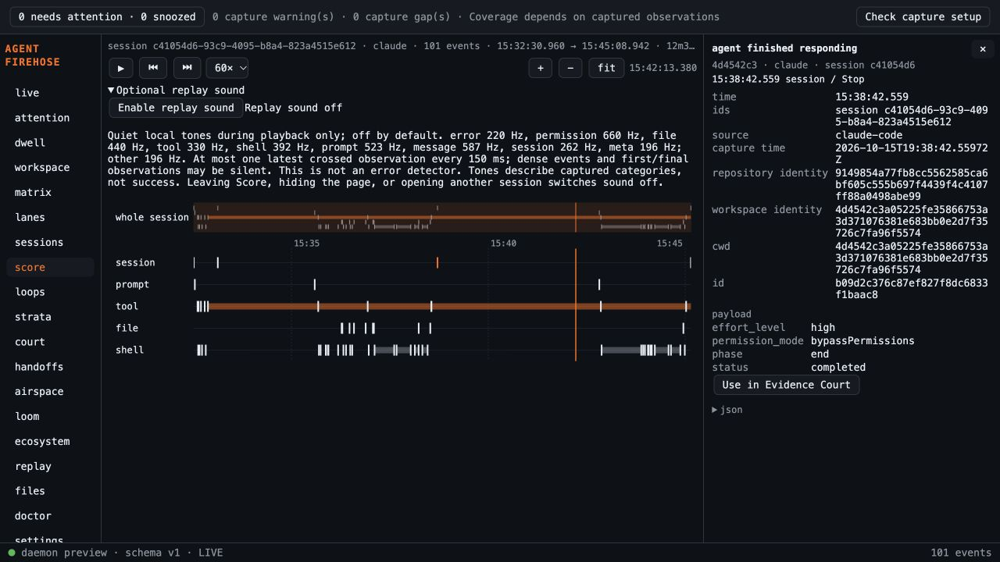

# Score optional sound validation

Base: main 767f7cc607c267edb2100c5c7284eb082c052a77 after the explicitly authorized PR #51 merge. Branch: codex/score-sonification. Reviewed application code: cb561f8. Later documentation changes do not change runtime behavior.

- TDD: failing public audio-host and Score DOM tests preceded implementation. Additional failing regressions drove select() seek cleanup and native summary keyboard handling. Real captured Score fixture is reused with labelled normalized category/time mutations; no adapter payloads were invented.
- Stable final serial frontend run: **786 tests across 61 files pass**, production TypeScript/Vite build passes. Empty gofmt, go vet, full Go tests and CLI build pass. Sidecar rebuilt for macOS arm64; all 3 Rust tests pass.
- Earlier runs overlapped edits or competing tests: stale seek regression and timing failures occurred. One Ecosystem run reported an identifier absent from both checked-out and baseline source; targeted and full stable reruns passed without editing Ecosystem. Cause not established; no thresholds weakened.
- Sonnet 5.5 High plan and implementation reviews produced fixes; final bounded review through cb561f8 PASS. Independent specification and standards follow-ups PASS. See adjacent review report for findings and dispositions. Argon substantive quota was exhausted earlier today; no unavailable review counted as approval.
- Browser interaction: actual Capture Engine Admit and daemon Handler, temporary isolated home/spool, existing 101-event captured Claude fixture, no sources/hooks/user configuration. On allowed localhost:1420 with daemon port 4638, enabled actual browser AudioContext, played at 60x, paused, navigated away and returned; UI state returned to off requiring new opt-in. Screenshot records returned off state. Temporary helper removed and both preview servers stopped.
- Browser proof predates the final seek/summary fixes; those fixes have focused regression tests and final full-suite coverage. This proves browser controls/API state, not human auditory perception, device loudness or installed-native behavior.
- Off by default, no persistence, network or capture/API changes. Latest crossed observation only; dense, first and final events may be silent. Quiet tones are not an error detector. Lifecycle stops prioritize immediate silence.

Hosted exact-head platform checks remain a separate publication gate. New PR remains unmerged pending human approval.

