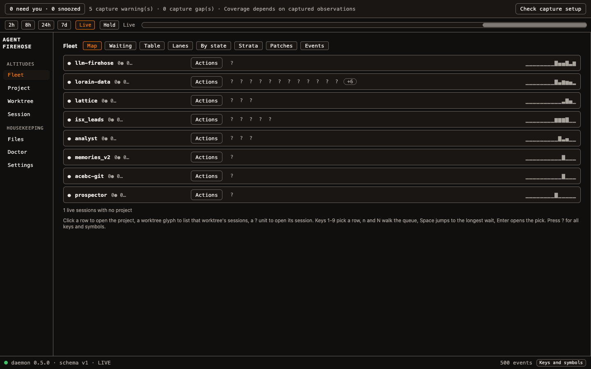
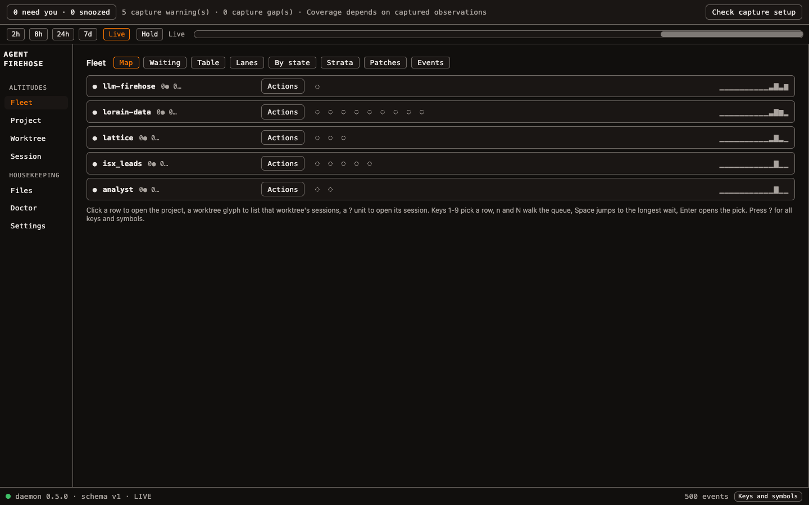
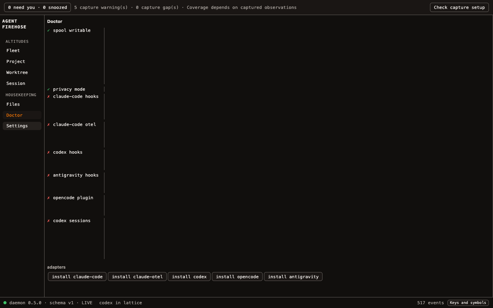
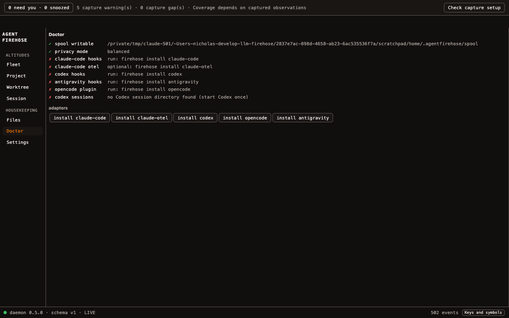
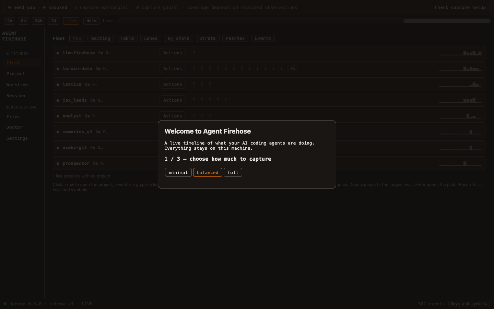
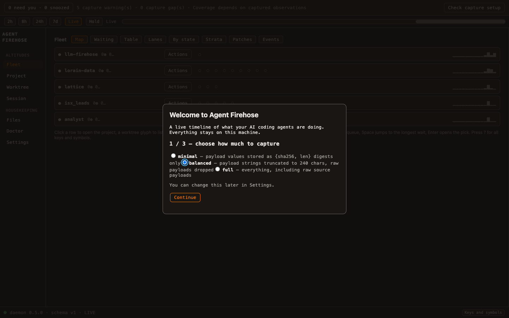

# HCI review of the desktop shell

**Date:** 2026-11-08. **Tree reviewed:** `origin/main` at 45b3aeb.
**Method:** code read of `apps/tauri-desktop/src`, plus the running UI in headless Chromium
at 1440×900 and 1000×700. The daemon was isolated on a scratch HOME (port 4599, never 4517)
with a copy of recent spool days. Read-only `GET /worktrees` against the real daemon supplied
the state counts in finding 1. Onboarding was viewed without saving anything.
**Baseline:** [`2026-11-01-impeccable-audit-workspace-and-app.md`](2026-11-01-impeccable-audit-workspace-and-app.md).
This report covers only what was still open or new.

**Verdict:** the structure is now sound and most of the November audit is closed. What
remained was mostly about trust: Fleet's main signal was ambiguous, the Doctor's fix text was
invisible, and the shell moved under the pointer. Findings 1 to 5 were fixed in
[PR #86](https://github.com/treetopdevs/llm-firehose/pull/86), merged the same day.

## Fixed in PR #86

| # | Problem | Evidence at 45b3aeb | Fix |
|---|---|---|---|
| 1 | `?` meant both "needs you" and "unknown" on Fleet | `glyphs.ts:9,15`. 27 `?` units on Fleet while the strip read "0 need you". The real daemon had 695 of 956 worktrees `unknown` | Unknown worktrees draw `◌` |
| 2 | Doctor and onboarding explanations were invisible | The detail span inherited the side pane's `.detail { width: 0; overflow: hidden }` (`styles.css:207`) | Renamed to `.doctor-detail` |
| 3 | The sidebar moved 35px between panels | Session nav top 266 vs 231. After clicking Worktree, the pointer sat on Session | The hidden time bar keeps its row |
| 4 | Panels showed raw exceptions | Offline Worktree read `TypeError: Failed to fetch` | `failureMessage()` says what failed and what happens next |
| 5 | Onboarding saved an unexplained privacy mode on one click, with no dialog semantics | `onboarding.ts:32`, no `role`, `aria-modal` or focus trap | Mode descriptions, save on Continue, modal dialog, focus trap, back step |

Review of the PR added one more fix: finishing onboarding now hands focus to the Doctor panel
rather than leaving it on `<body>`.

**Trade-off taken:** panels without the time bar show an empty 35px band, in exchange for a
shell that stays still. Moving the bar inside the panels that use it is the alternative.

**Still using `?`:** Project's `landed ?` label and its axis-tick fallback.

| | Before | After |
|---|---|---|
| Fleet |  |  |
| Doctor |  |  |
| Onboarding |  |  |

The "after" onboarding capture predates the final CSS that puts each privacy mode on its own
line, so its options still run together. That change has unit-test coverage only. The `✗`
rows on Doctor come from the scratch HOME, not from a real install.

## Still open

6. **Permanent alarm text.** "5 capture warning(s) · Coverage depends on captured observations"
   sits on every screen, even with nothing needing you (`attention.ts:281`). Keep the strip
   for needs-you and move warnings to a badge on Doctor.
7. **No app-wide ⌘K.** It did nothing on Fleet, and only the graph has search, though
   `PRODUCT.md` promises it. With 128 sessions, jump-to-session by name is the biggest
   navigation gain available.
8. **"Waiting" and "Needs you" show the wrong things.** Fleet › Waiting lists working and done
   sessions. The inbox shows working sessions under a "Needs you" heading at zero needs, and
   "Enable notifications" sits above the content.
9. **Worktree is still a card stack.** Each card is about 100px tall with a full UUID, so
   seven fit per screen, and the list uses half the window until one is selected. The nav
   label says Worktree, but the panel lists sessions.
10. **Small targets.** 52 of 69 controls on Fleet are under 24px tall (WCAG 2.5.8), and
    Project has 20 of 32. Eight equally loud "Actions" buttons outweigh the data.
11. **Harness noise and long titles.** Title-generation runs appear as real sessions, and one
    title wraps to seven lines in Waiting. Hide them by default and clamp titles to one line.

**Polish**

- Tabs come in three styles: Fleet left-aligned, Project right-aligned, Session teal segmented.
- Hint text is sans on Fleet and mono on Project, and stays permanent now that the `?` legend exists.
- The empty Session panel shows live playback controls and says "sessions panel", a name that
  no longer exists ([capture](2026-11-08-hci-review/before/session.png)).
- Score's `15:05 → 14:51 · 47h45m` has no dates.
- From code only, not measured: the event list still rebuilds in full (`events/index.ts:186`),
  and the attention strip and inbox rebuild on each 3s poll (`attention.ts:255,507`).

## Closed since 2026-11-01

Nav naming and `aria-current`, the shared time bar, session names in Attention, keyboard
activation on rows, the `?` legend, global focus styles, type tokens, and the graph timeline cap.

## Known test issue

`graph/index.requests.test.ts` ("live-event bursts…") times out at 5s in full-suite runs. It
fails the same way on 45b3aeb and passes alone.

## Not covered

The TUI; Fleet's Lanes, Strata and Patches tabs; Project's Graph and Map tabs; and screen-reader
testing. The worktree `graph_unavailable` reason seen in the browser came from the scratch
HOME; the real daemon's most common reason is `repo_unregistered`.

Captures that show captured session logs (Worktree, the inbox, Score) are deliberately left
out of this public repository.
